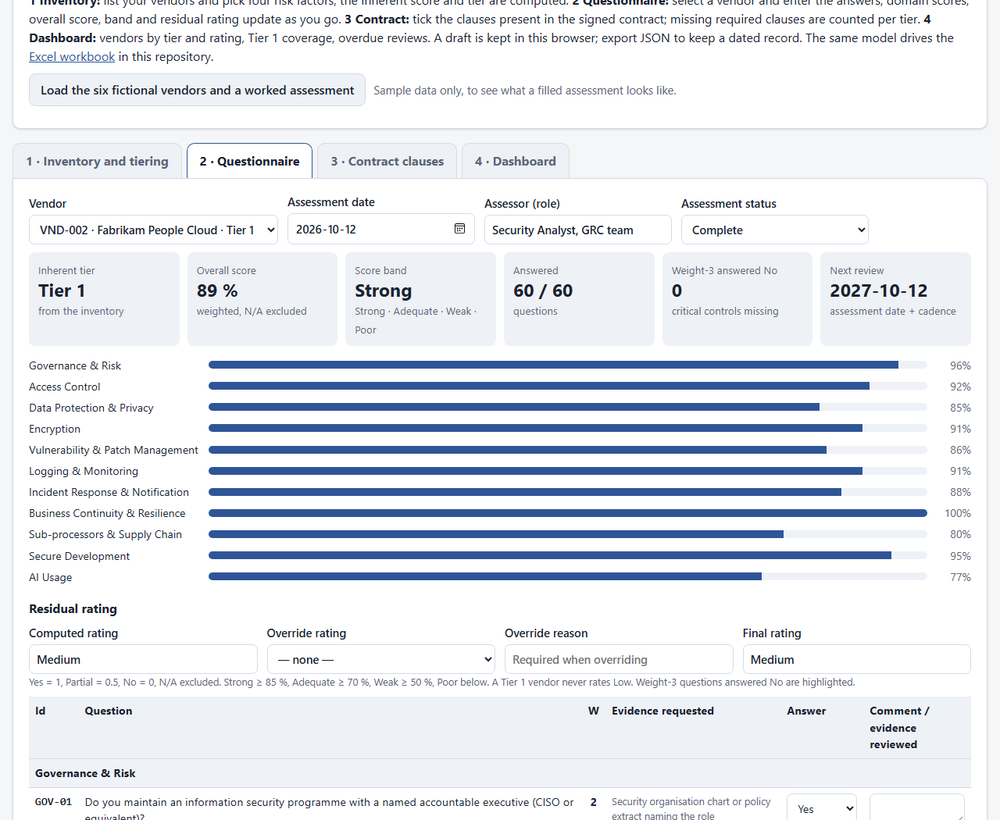

# Vendor Risk Assessment Template (TPRM)

[](LICENSE) [](https://github.com/bizidwassim-design/vendor-risk-assessment-template/actions/workflows/ci.yml) [](SECURITY.md) [](https://bizidwassim-design.github.io/vendor-risk-assessment-template/)

[](https://bizidwassim-design.github.io/vendor-risk-assessment-template/)

A free, open-source **third-party risk management** kit: tier your vendors by inherent risk, send them a
60-question security questionnaire, score the answers, derive a residual rating, check the contract and report
on a dashboard. One Excel workbook (no macros), a sendable questionnaire in Markdown and CSV, and a standards map
to **ISO/IEC 27001:2022**, **NIST CSF 2.0**, **SOC 2** and **ISO/IEC 42001:2023**. The same model also runs as a
**web app**, one static page with no build and no server: **[use it online](https://bizidwassim-design.github.io/vendor-risk-assessment-template/)**
(append `?sample=1` for the worked example).



> 🇫🇷 Résumé en français en bas de page.

## Layout

```
index.html, assets/, data/tprm.js     the web app (strict Content-Security-Policy, no external resources; data file generated)
scripts/build_web_data.py              writes data/tprm.js from the build script so the app and the workbook never drift
Vendor-Risk-Assessment-Template.xlsx   the workbook (generated - do not edit by hand)
scripts/build_template.py              generates the workbook and the questionnaire exports (openpyxl)
questionnaire/vendor-questionnaire.md  the same 60 questions as a form you can send to a vendor
questionnaire/vendor-questionnaire.csv the questions as data (import into a GRC tool or a form builder)
docs/standards-mapping.md              what each sheet gives you for ISO 27001, NIST CSF 2.0, SOC 2, ISO 42001
```

## Quick start

**Online:** open the [web app](https://bizidwassim-design.github.io/vendor-risk-assessment-template/), add your vendors in
*Inventory*, answer the questionnaire per vendor, tick the contract clauses, read the dashboard; export JSON to keep a dated
record. Nothing is sent anywhere; the draft stays in your browser.

**Workbook:**

1. Download `Vendor-Risk-Assessment-Template.xlsx` and open it in Excel, LibreOffice or Google Sheets.
2. Read `01_Methodology`; adjust the factor values and review cadence if your policy differs.
3. List vendors in `02_Vendor_Inventory` and pick the four risk factors from the drop-downs. Score and tier are computed.
4. Send `questionnaire/vendor-questionnaire.md` to the vendor. When the answers come back, select the vendor at the top
   of `03_Questionnaire` and enter them. Domain scores, overall score and score band update as you type.
5. Add a row per vendor in `04_Assessment_Summary`. Residual rating, next review date and the overdue flag are formulas.
6. Select the vendor in `05_Contract_Clauses_Checklist` and tick the clauses against the signed contract.
7. Use `06_Dashboard` in your management review.

**Conventions:** blue text = input · black on grey = formula · red = overdue or missing required clause ·
yellow row in the summary = the vendor currently loaded in the questionnaire.

## What's inside

| Sheet | What it does |
|-------|--------------|
| `01_Methodology` | Tiering model, factor tables (editable), due-diligence depth and cadence per tier, scoring rules, residual-rating matrix, step-by-step |
| `02_Vendor_Inventory` | 20 rows, 6 fictional vendors filled. Inherent score and tier computed from data classification × criticality × access × AI use |
| `03_Questionnaire` | 60 questions in 11 domains, answer drop-down (Yes / Partial / No / N/A), weight 1–3, evidence requested, automatic domain and overall scores |
| `04_Assessment_Summary` | Per vendor: tier, score, score band, computed rating, optional override with reason, final rating, next review (cadence by tier), overdue flag in red |
| `05_Contract_Clauses_Checklist` | 18 minimum clauses with Required / Recommended / Optional per tier; Y/N against the contract; missing required clauses counted |
| `06_Dashboard` | Vendors by tier and by residual rating, Tier 1 coverage, overdue reviews, assessment status, two charts |

### The tiering model

```
Inherent score = Data classification (1-4) × Business criticality (1-4) × Access type (1-4) × AI use (1-2)
Tier 1 (critical)  score >= 36      full due diligence, review every 12 months
Tier 2 (important) score 12-35      full questionnaire, lighter evidence, review every 24 months
Tier 3 (standard)  score < 12       short form, standard terms, review every 36 months
```

AI use doubles the score on purpose: a vendor that runs models on your data is assessed earlier and deeper.

### From score to residual rating

Answers earn `weight × (Yes = 1, Partial = 0.5, No = 0)`; N/A is excluded. The percentage obtained gives a score band
(Strong ≥ 85 %, Adequate ≥ 70 %, Weak ≥ 50 %, Poor). Tier and band give the residual rating:

| Tier \ Band | Strong | Adequate | Weak | Poor |
|-------------|--------|----------|------|------|
| Tier 1 | Medium | High | Critical | Critical |
| Tier 2 | Low | Medium | High | High |
| Tier 3 | Low | Low | Medium | Medium |

A Tier 1 vendor never rates Low: concentration and dependency risk remain even with strong controls. Use the override
column (with a written reason) when one critical finding justifies a different rating in either direction.

### Questionnaire domains

Governance & risk · Access control · Data protection & privacy · Encryption · Vulnerability & patch management ·
Logging & monitoring · Incident response & notification · Business continuity & resilience · Sub-processors & supply
chain · Secure development · AI usage. Weight-3 questions answered *No* are flagged in red and counted separately.

## Design choices

* **One questionnaire sheet, one vendor at a time.** Save a copy per vendor or keep the evidence folder reference in the
  summary. The summary pulls the live score automatically for the vendor currently loaded.
* **Everything is a formula you can read.** `VLOOKUP`, `INDEX/MATCH`, `SUMPRODUCT`, `COUNTIFS`, `EDATE`, `TODAY` only.
  No macros, no named ranges, no add-ins, so it works in LibreOffice Calc and Google Sheets.
* **Factors and cadences are cells, not constants.** Re-calibrate in `01_Methodology`; the inventory and summary follow.
* **Questions are data.** `scripts/build_template.py` holds the question list once and writes the workbook, the CSV and
  the Markdown form from it. CI rebuilds all three and fails if they drift.

## Sample data

Six fictional vendors (Contoso Cloud Platform, Fabrikam People Cloud, Northwind Logistics, Litware Insight, Proseware
Managed IT, Wingtip Print & Promo) with a worked questionnaire for the HR SaaS vendor, one overdue review, one override and
one contract check with missing clauses. Delete them before real use.

## Rebuilding from source

```bash
pip install openpyxl
python scripts/build_template.py
```

The build writes the workbook and both questionnaire exports. Verified by fully recalculating in Microsoft Excel 16 with
zero error cells.

## Related repositories

| Repository | How it connects |
|------------|-----------------|
| [application-risk-assessment-template](https://github.com/bizidwassim-design/application-risk-assessment-template) | Same style of workbook for application risks; vendor findings often become risks in that register |
| [grc-control-crosswalk](https://github.com/bizidwassim-design/grc-control-crosswalk) | Cross-reference of ISO 27001, NIST CSF 2.0, CIS v8 controls behind the mapping in `docs/` |
| [iso27001-iso42001-toolkit](https://github.com/bizidwassim-design/iso27001-iso42001-toolkit) | Supplier security policy and AI policy that this template operationalises |
| [ciso-executive-dashboard](https://github.com/bizidwassim-design/ciso-executive-dashboard) | Executive view where the Tier 1 coverage and overdue counts belong |
| [soc-detection-playbooks](https://github.com/bizidwassim-design/soc-detection-playbooks) | What the SOC does when a vendor reports an incident (notification clause CL-05) |
| [public-scripts](https://github.com/bizidwassim-design/public-scripts) | Scripts that can feed inventory data (for example enterprise-app and OAuth-grant exports) |

## Contributing

Better questions, additional clause templates, translations and mapping fixes are welcome — see
[CONTRIBUTING.md](CONTRIBUTING.md) and the [Code of Conduct](CODE_OF_CONDUCT.md). Keep sample data fictional.

## Disclaimer

This template supports, but does not replace, legal review of contracts, professional judgement or a certification
audit. A questionnaire measures what a vendor says; evidence and contract terms are what protect you. Use roles, not
names, and keep vendor evidence outside this file.

## License

[MIT](LICENSE) — free to use, copy, modify and redistribute.

---

## 🇫🇷 Résumé

Kit **open source** de gestion des risques fournisseurs (TPRM) : classement des fournisseurs en trois niveaux selon le
risque inhérent (classification des données × criticité × type d'accès × usage de l'IA), questionnaire de sécurité de
60 questions en 11 domaines avec score automatique, cotation résiduelle, liste de clauses contractuelles minimales par
niveau, et tableau de bord. Aligné sur **ISO/IEC 27001:2022** (A.5.19 à A.5.23), **NIST CSF 2.0** (GV.SC), **SOC 2**
(CC9.2) et **ISO/IEC 42001:2023** (A.10). Sans macro ; tous les fournisseurs d'exemple sont fictifs. Le classeur, le
questionnaire Markdown et le CSV sont générés par `scripts/build_template.py` (`pip install openpyxl`).
